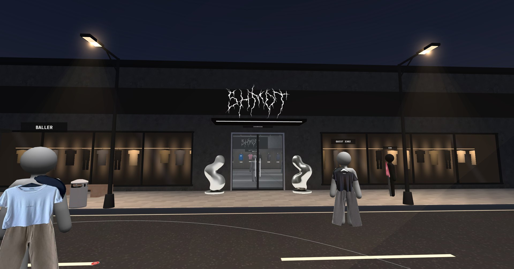
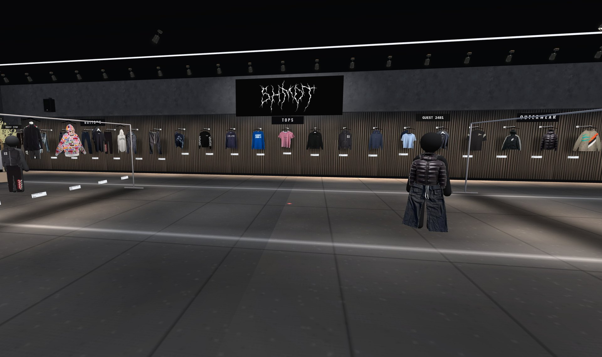
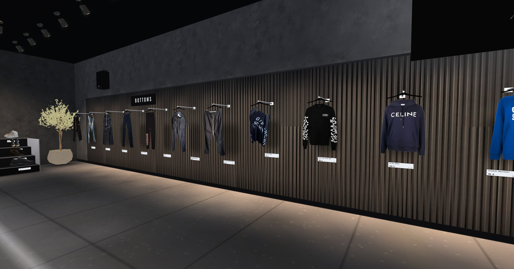
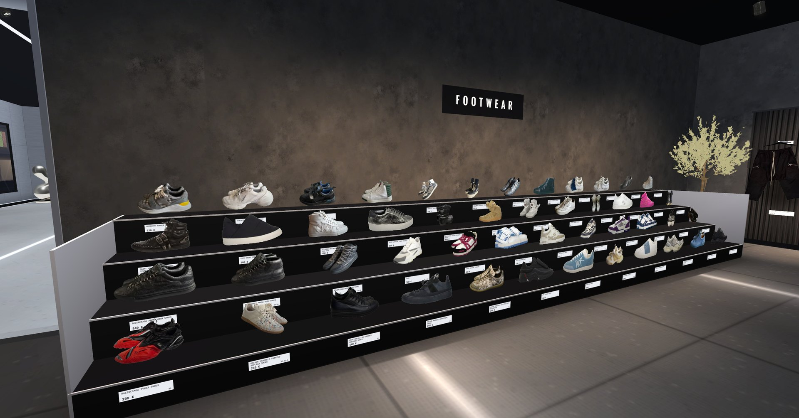
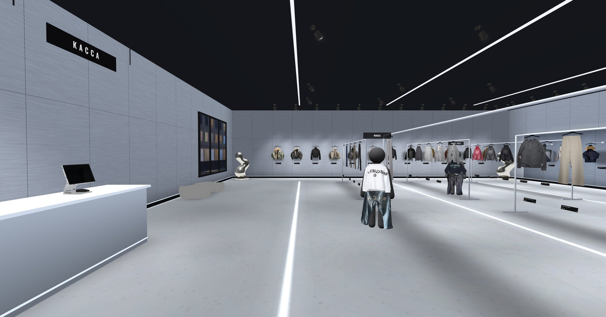
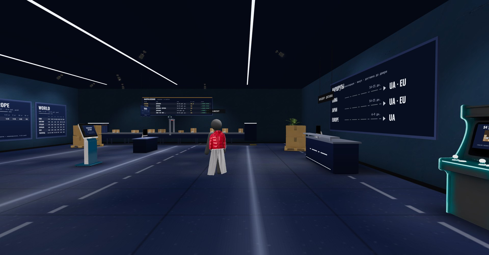
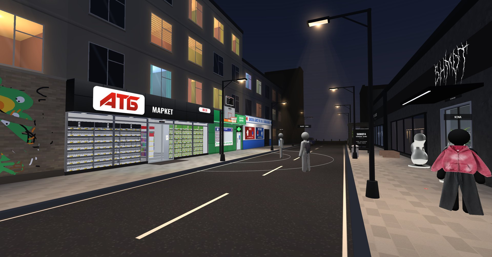
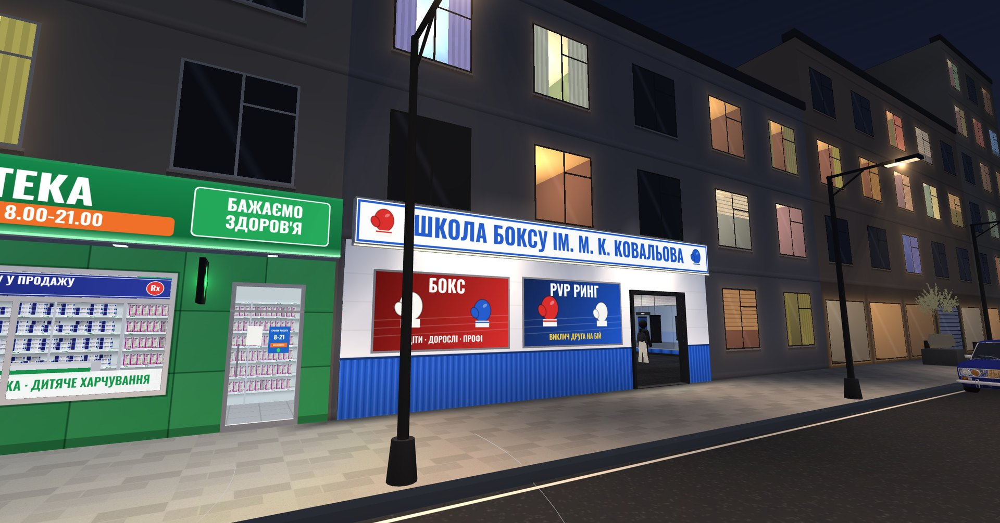
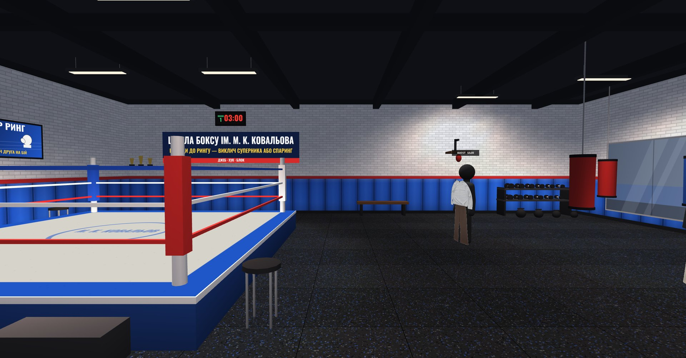
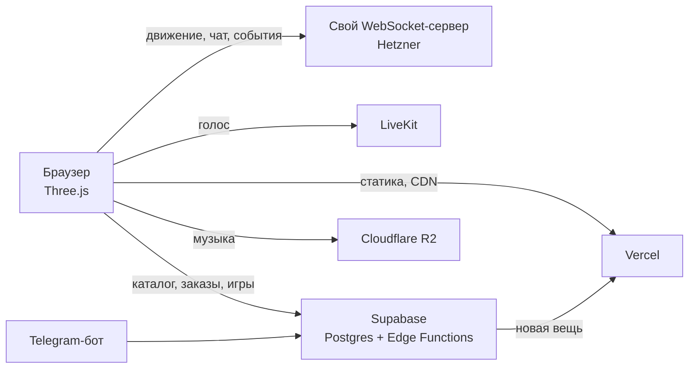

# SHMOT4 WORLD

**3D-магазин одежды в браузере, по которому гуляют вместе.** → [shmot4.world](https://shmot4.world)

Шоурум, в который заходишь как в настоящий: три зала, улица с соседними магазинами, на вешалках настоящие вещи из Telegram-канала, а рядом живые покупатели, которых видно и слышно. Сайт открывается по ссылке на телефоне и компьютере, ставить ничего не нужно.

> Это витрина проекта. Исходный код закрыт и принадлежит автору; см. [LICENSE](LICENSE).

## Что внутри

| | |
|---|---|
|  |  |
| **Showroom.** Вещи в наличии, каждая в одном экземпляре | Вещь с ценником: нажал, выбрал размер, оформил заказ |
|  |  |
| Ступени с обувью | **Blanks.** Базовые вещи под заказ |
|  |  |
| **S4 Logistics.** Доставка из Китая, Японии и Европы, калькулятор | Ночная улица: АТБ, аптека, баскетбольная площадка |
|  |  |
| Школа бокса напротив магазина | PvP-ринг: бой 1 на 1 с другим посетителем |

## Как это работает

- **Магазин живёт в Telegram-боте.** Владелец присылает фото, название и цену. Бот вырезает фон нейросетью, и через минуту вещь висит в зале на своей вешалке. Там же он подтверждает оплату, снимает вещи и меняет музыку.
- **Наличие на лету.** Купленная вещь пропадает у всех посетителей сразу, а бронь ставится атомарно на сервере.
- **Люди рядом.** Все в одной комнате: видят друг друга, пишут в чат и говорят голосом с объёмным звуком (чем ближе человек, тем громче).
- **Игры для удержания.** Баскетбол на 1, 2 и 3 очка, PvP-бокс, ежедневная охота за стикерами, аркада с недельным рейтингом и скидкой, общая граффити-стена, синхронное радио.
- **Редактор зала.** Админ переставляет вещи и объекты прямо на сайте и публикует изменения без пересборки.

## Архитектура

## Цифры

- **150 человек в одной комнате.** Нагрузочный тест: 149 ботов + реальная страница. Все видят всех, движение плавное (0,1 % кадров без движения), 38 КБ/с на игрока.
- **Сервер движения за €7.85 в месяц.** При 149 игроках он загружен на 20 % одного ядра.
- **330 КБ кода** (gzip). Свет запечён в вершины, текстуры частично рисуются кодом, разрешение подстраивается под устройство на ходу.

## Стек

Three.js · esbuild · Supabase (Postgres, Edge Functions, RLS) · Vercel · LiveKit · Node.js + ws на Hetzner за Caddy · Cloudflare R2 · Telegram Bot API

## Фрагменты

Пара небольших кусков, чтобы было понятно, как это устроено:

- [snippets/dead-reckoning.js](snippets/dead-reckoning.js): плавное движение других игроков без телепортов при редких сообщениях.
- [snippets/procedural-texture.js](snippets/procedural-texture.js): текстура резинового пола спортзала, нарисованная кодом без загрузки картинок.

---

Автор: [@developeraw](https://t.me/developeraw)
